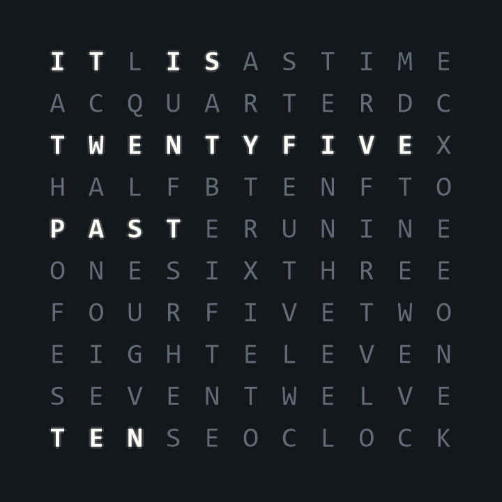
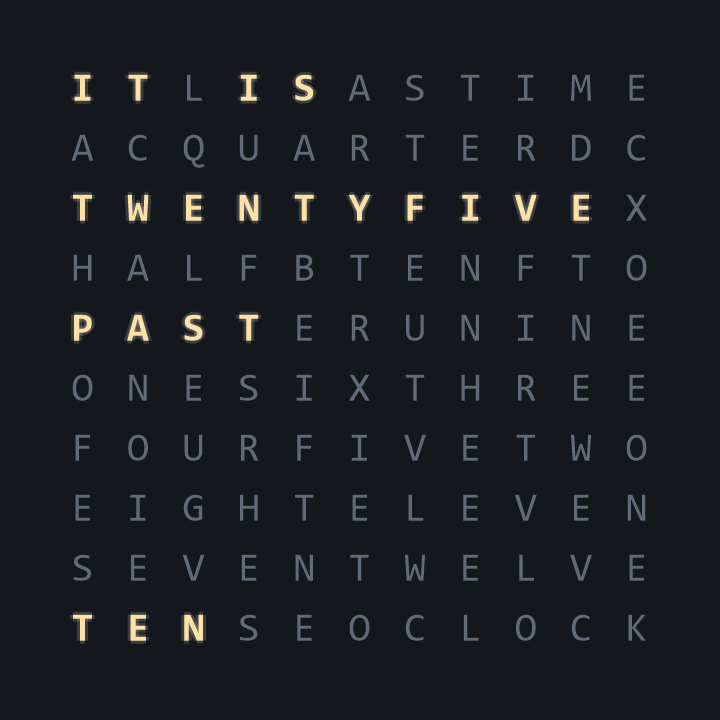

# Voltura TextClock

**Time, in words.** A little character for your Windows desktop.

[Product website](https://textclock.voltura.se/) · [Download the latest release](https://github.com/voltura/VolturaTextClock/releases/latest) · [Release notes](https://github.com/voltura/VolturaTextClock/releases) · [Report an issue](https://github.com/voltura/VolturaTextClock/issues)



An unhurried way to read the time. TextClock lights up words in English or Swedish, stays where you put it, and gives you room to make it your own.

- **Your kind of clock:** choose fonts, active and inactive colors, glow, optional flicker, and a background image.
- **English and Swedish:** choose the clock language and interface language independently, or follow Windows.
- **Quietly useful:** pin above other windows, minimize to the taskbar, and optionally start with Windows.
- **Preview as you go:** try appearance changes before saving.
- **Local and independent:** works offline, without an account or subscription. No telemetry or advertising.

## Get TextClock

Use Windows 10 or 11, **64-bit x64**. [Open the latest release](https://github.com/voltura/VolturaTextClock/releases/latest) and choose:

| Download | Best for |
|---|---|
| `VolturaTextClock-Setup-…-win-x64.exe` | Standard per-user installation. Installs the .NET 10 Desktop Runtime from Microsoft if needed. |
| `VolturaTextClock-Setup-…-win-x64-full.exe` | Offline installation with the runtime included. |
| `VolturaTextClock-…-win-x64.zip` | Portable use: extract the entire ZIP and open `VolturaTextClock.exe`. Runtime included. |

The app and installer are signed and timestamped with Voltura's existing **self-signed** certificate. This does not establish a publicly trusted Windows publisher, and Windows may still display a warning. Download only from this repository's releases or the product website.

## Make it yours

Open the three-line control in the clock's corner. Use the sliders button for **Settings**, the pin to keep the clock on top, or the minimize button to put it in the taskbar.

Settings has three tabs: **General**, **Appearance**, and **Updates & About**. Choose fonts and colors, try Original, Brushed metal, Rust, a plain background, or your own PNG/JPEG/bitmap, and watch the live preview. Save applies your choices; Cancel leaves the clock unchanged.



Clock words round to the nearest five minutes. Swedish and English use their own natural wording, including Swedish half-hour expressions. Other Windows display languages fall back to English.

## Updates and privacy

Startup and automatic startup update checks are off by default. Installed copies can check for an update, download it, and choose **Install and restart**. TextClock verifies the release's RSA-PSS signed manifest and installer size/SHA-256 before running setup, including a second verification before installation. Portable copies use a manual release download.

Existing settings are preserved during upgrades and kept on uninstall. They remain in `%LOCALAPPDATA%\VolturaTextClockAppsettings.json`; a malformed file is backed up before defaults are restored. Custom images stay on your computer and are not kept locked. [Privacy details](PRIVACY.md).

## Build and contribute

Use Windows, PowerShell 7, and the .NET 10 SDK pinned in `global.json`:

```powershell
./scripts/verify.ps1
dotnet run --project VolturaTextClock -c Release
```

See [contributing](CONTRIBUTING.md), [packaging and releases](docs/releasing.md), [verification](docs/verification.md), and the [security policy](SECURITY.md). The [historical scanning inventory](docs/security-maintenance.md) documents the individual 2020 Codacy findings and their current dispositions.

Free and open source under [GPL-3.0](LICENSE). Made by [Voltura AB](https://voltura.se/). [Third-party notices](THIRD-PARTY-NOTICES.md).
